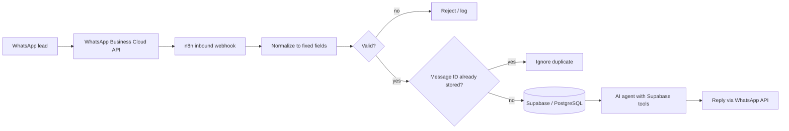

# Architecture

## Message flow

## Normalized message fields

Every inbound message is converted into the same set of fields before anything is saved:

| Field | Purpose |
|---|---|
| phone | Identifies the lead |
| message ID | Prevents the same message being stored twice |
| contact name | Lead display name |
| message type | Text, media, etc. |
| text | Message content |
| time received | Timestamp |

## Data model

Three entities in Supabase (PostgreSQL):

- **leads**: one row per lead, identified by phone number
- **conversations**: one conversation per lead, created by workflow rules
- **messages**: every message, unique by WhatsApp message ID

## Rule-based vs AI-driven

| Rule-based (fixed workflow logic) | AI-driven |
|---|---|
| Field validation | Understanding the lead's message |
| Duplicate checks | Writing the reply |
| Saving leads, conversations, messages | |
| Conversation creation | |
| Timestamps | |

Keeping the model out of core logic means a bad model answer cannot corrupt data.

## Testing (in progress)

The AI sales agent is being tested for natural conversation, edge cases and answers the AI makes up.
